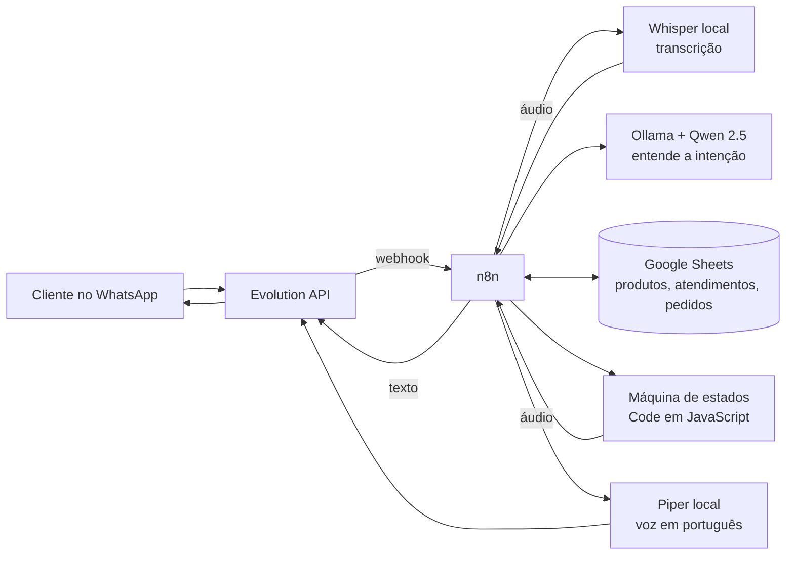

# GasBot — Agente de vendas de gás de cozinha no WhatsApp

Agente que atende clientes pelo WhatsApp, entende pedidos por **texto e por áudio**, calcula o valor a partir de uma planilha de preços, coleta nome e endereço, confirma o pedido (Pix, dinheiro com troco, cartão ou notinha) e registra tudo em uma planilha do Google Sheets.

Feito para **pequenos comerciantes locais**: roda no próprio computador, sem servidor pago, e usa uma planilha que o dono do negócio já sabe usar.

> **Status:** em fase de testes. Ainda não foi validado com clientes reais, então este repositório não traz números de resultado.

## Demonstração


_Atendimento real de teste: o cliente pede gás, informa os dados, corrige o pedido e paga. Dados sensíveis foram borrados._

## O que o agente faz

- Atende o cliente em linguagem simples, com mensagens curtas e emojis, como no WhatsApp.
- Entende **"gás normal"**, **"gás de cozinha"** e **"botijão comum"** como o botijão **P13**, e pergunta o modelo quando o cliente não informa.
- Aceita **mensagens de voz**: transcreve o áudio localmente e responde também **em áudio**, para quem prefere ouvir.
- Coleta os dados que faltam, sem repetir perguntas já respondidas: produto, quantidade, forma de pagamento, nome e endereço.
- **Nunca inventa preço.** O valor vem sempre da aba de produtos da planilha.
- Mostra o resumo do pedido e deixa o cliente corrigir qualquer item (produto, quantidade, pagamento, nome ou endereço).
- Pagamento em **dinheiro**: pergunta se precisa de troco e para quanto.
- Pagamento por **Pix**: envia a chave e espera o comprovante.
- Reconhece cliente antigo, reaproveita o cadastro e permite um novo pedido na mesma conversa.
- Corrige **vários itens de uma vez** (ex.: "quantidade e endereço") e pergunta um de cada vez.
- Entende o valor do troco em vários formatos (`50`, `10.500`, `11.000,00`).
- Encerra o atendimento quando o cliente desiste ("não quero", "nenhum", "deixa pra lá") ou responde "sim" por engano.
- Ignora mensagens que não são sobre gás e grupos, para não gastar processamento nem responder o que não deve.

## Como funciona



A conversa é controlada por uma **máquina de estados** escrita em JavaScript, dentro de um nó *Code* do n8n. Cada etapa sabe o que perguntar e o que fazer com a resposta:

`AGUARDANDO_NOME → AGUARDANDO_PRODUTO → AGUARDANDO_QUANTIDADE → AGUARDANDO_PAGAMENTO → CONFIRMAR_PEDIDO → AGUARDANDO_TROCO (dinheiro) / AGUARDANDO_COMPROVANTE_PIX → CRIAR_PEDIDO → PERGUNTAR_ALGO_MAIS → FINALIZADO`

A IA local entende o que o cliente quer, e as regras de negócio ficam em código. Isso evita que o modelo invente preço ou pule etapas.

## Tecnologias

| Parte | Ferramenta |
|---|---|
| Automação do fluxo | n8n (instalação local) |
| WhatsApp | Evolution API v2 (Docker) |
| Interpretação da intenção | Ollama com Qwen 2.5 (3B), executado localmente |
| Transcrição de áudio | Whisper (faster-whisper, modelo `small`), local |
| Voz das respostas | Piper TTS (voz `pt_BR-faber-medium`), local |
| Dados | Google Sheets |
| Regras do atendimento | JavaScript nos nós *Code* do n8n |

## Planilha

O workflow usa **3 abas** do Google Sheets: `Produtos` (código, preço à vista e preço notinha), `Atendimentos` (conversa em andamento) e `Pedidos` (pedidos finalizados). Um modelo vazio está em `planilha/GasBot_modelo_planilha.xlsx`.

## Como instalar

Requisitos: Docker, n8n, Ollama e uma conta Google.

1. **n8n:** instale e abra em `http://localhost:5678`.
2. **Evolution API:** suba o container, crie uma instância e leia o QR Code com o WhatsApp. Configure o webhook para a URL de produção do n8n, com o evento `MESSAGES_UPSERT`.
3. **Ollama:** `ollama pull qwen2.5:3b`.
4. **Whisper (transcrição):**
   ```
   docker run -d --name whisper -p 9000:9000 -e ASR_MODEL=small -e ASR_ENGINE=faster_whisper onerahmet/openai-whisper-asr-webservice:latest
   ```
5. **Piper (voz):**
   ```
   docker run -d --name gasbot_voz --restart unless-stopped -p 5051:5000 -e PORT=5000 -v gasbot_voz_data:/data kamilkrawiec/piper-openai-tts
   ```
6. **Planilha:** copie o modelo da pasta `planilha/` para a sua conta Google e conecte no n8n.
7. **Workflow:** importe `workflow/gasbot.json` no n8n e troque `COLE_AQUI_A_CHAVE_DA_EVOLUTION` pela chave da sua Evolution, `ID_DA_SUA_PLANILHA` pelo ID da sua planilha e reconecte a credencial do Google Sheets. O arquivo **não contém chaves nem telefones reais** (a chave Pix e o nome da empresa são exemplos).
8. Preencha os preços na aba `Produtos` e ative o workflow.

## Monitoramento (opcional)

Na pasta `monitoramento/` há dois workflows extras do n8n:

- `gasbot_vigia.json`: de tempos em tempos confere se WhatsApp, Ollama, Whisper e Piper estão no ar, avisa por e-mail e tenta reconectar o WhatsApp sozinho.
- `gasbot_erros.json`: manda e-mail quando o fluxo principal der erro.

Troque `SEU_EMAIL@gmail.com` e `COLE_AQUI_A_CHAVE_DA_EVOLUTION` pelos seus dados.

## Cuidados

- **Dados pessoais:** o agente guarda nome, telefone e endereço de clientes. Quem usar deve seguir a **LGPD** e informar o cliente.
- **WhatsApp não oficial:** a Evolution API conecta pelo WhatsApp Web e existe risco de bloqueio do número. Para uso comercial, avalie a API oficial do WhatsApp Business.
- **Chaves e telefones:** nunca publique chaves de API, a chave Pix ou números reais.
- **Teste antes de usar:** o agente está em fase de testes.

## Próximos passos

- Voz clonada do dono do negócio (ElevenLabs), de forma opcional.
- Painel simples com os pedidos do dia.
- Aviso automático ao entregador.
- Versão para servidor na nuvem.

## Autor

**Ivan Silva** — Arapongas, PR.
Formação em Engenharia da Computação e experiência em operações e almoxarifado, aplicando automação e dados em problemas do pequeno comércio.

GitHub: [IvanLiraSilva](https://github.com/IvanLiraSilva)
